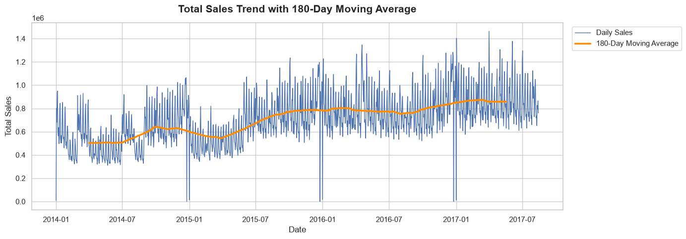
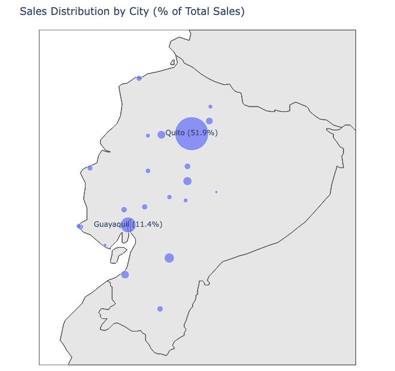
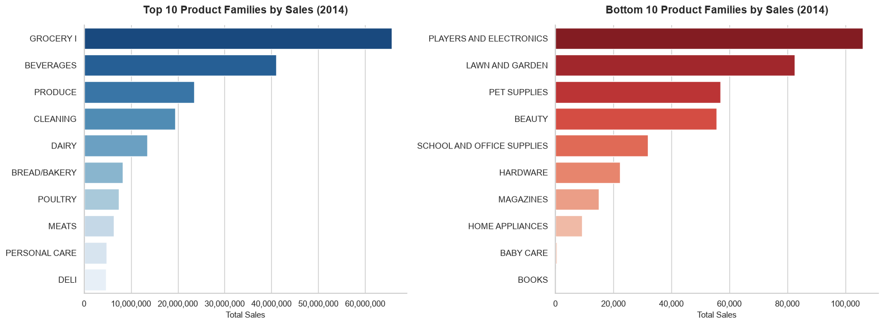
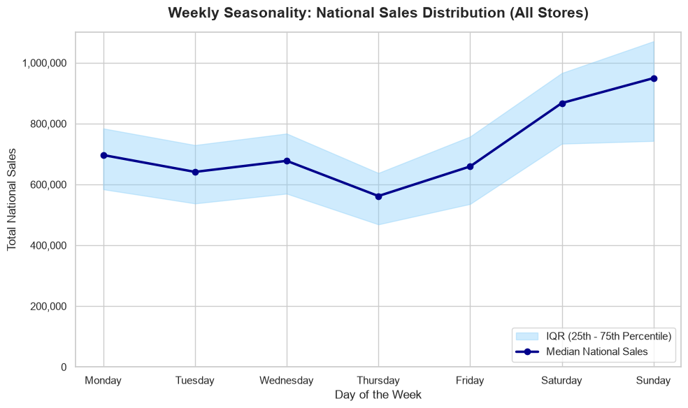
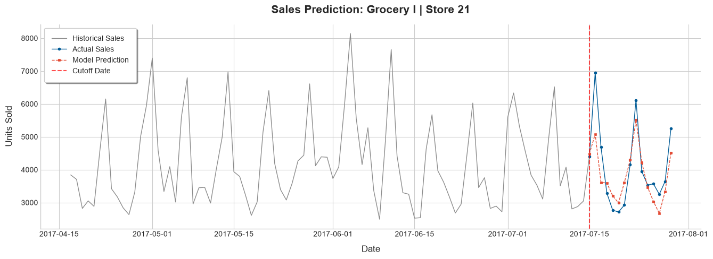
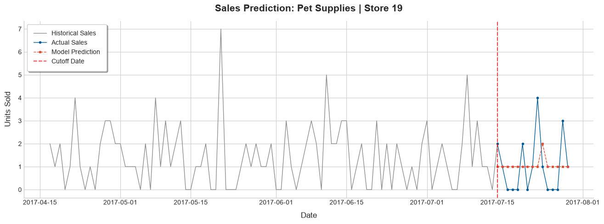

# Store Sales Time Series Forecasting

> **WORK IN PROGRESS:** *This project is currently under active development.*

An end-to-end machine learning project to predict store sales for Corporación Favorita (Ecuador), using historical daily data across 54 stores and 33 product families (2013–2017) from the [Kaggle Store Sales competition](https://www.kaggle.com/competitions/store-sales-time-series-forecasting).

This project goes beyond standard Jupyter Notebook experimentation by applying software engineering best practices—modular code, automated testing, and Continuous Integration (CI). By prioritizing testability, it ensures that the EDA and modeling phases are built on a highly reliable data foundation.


## Business Problem

Accurate forecasting of product sales is critical for brick-and-mortar grocery retailers. Overstocking leads to food waste and excessive storage costs, while understocking causes lost revenue and customer dissatisfaction. This project aims to build a robust machine learning model capable of accurately predicting unit sales for thousands of items across different stores, optimizing supply chain and inventory operations.

## Project Lifecycle

1. **Data Pipeline (Completed):** Modular preprocessing pipeline with automated tests to prevent data leakage, handle missing dates, and avoid merge explosions.
2. **Exploratory Data Analysis (Completed):** Analysis of long-term sales trends, geographic concentration, product family dispersion, and weekly seasonality.
3. **Baseline Modeling & Diagnostics (Completed):** Strict temporal validation setup (4 cutoffs, 15-day horizon) and parsimonious autoregressive XGBoost baseline.
4. **Feature Engineering & Error Analysis (Completed):** Systematic evaluation of temporal, store, family, event, and promotion features, reducing Global RMSLE from `0.545` to `0.485`.
5. **Advanced Modeling & Evaluation (In Progress):** Addressing structural limitations (trend extrapolation, zero-inflated demand, and bias calibration) before incorporating external regressors.


## Exploratory Data Analysis (EDA)

The aggregated view of the time series reveals a clear upward trend in sales. This growth over time already points to a key challenge for the modeling phase: the inability of gradient boosting models to extrapolate beyond historical values.

<p align="center">
  
  <br>
  <em>Figure 1: Aggregated sales trend over time.</em>
</p>

Beyond the overall trend, the sales distribution is highly uneven across three main dimensions:

**Location:** More than 50% of total sales are concentrated in Quito, the capital.

<p align="center">
  
  <br>
  <em>Figure 2: Sales distribution by city.</em>
</p>

**Product Family:** Demand varies drastically by category; some families barely sell (e.g., `BOOKS`), while the top performer reaches around 60M in sales in a single year.

<p align="center">
  
  <br>
  <em>Figure 3: Top and bottom product families by sales.</em>
</p>

**Day of the Week:** Sales also depend heavily on the weekday, peaking over the weekend (especially on Sundays) and dropping during the rest of the week.

<p align="center">
  
  <br>
  <em>Figure 4: Median sales by day of the week.</em>
</p>

## Baseline Modeling & Diagnostics

Before engineering complex features, a strict temporal validation framework was established to mirror production forecasting constraints and prevent data leakage:
- **Validation Strategy:** 4 temporal cutoffs (`2016-09-15`, `2017-01-15`, `2017-04-15`, `2017-07-15`) with a **15-day forecast horizon**.
- **Baseline Architecture:** An XGBoost regressor trained on `log1p(sales)` using a parsimonious 4-lag setup (`[15, 21, 28, 364]`), chosen via ACF/PACF analysis to capture recent inertia as well as weekly and yearly seasonality.

| Model | Features | Global RMSLE | Bias |
| :--- | :--- | :---: | :---: |
| XGBoost (Minimal) | 3 Lags (`15, 21, 364`) | 0.559 | -21.1 |
| **XGBoost (Selected Baseline)** | **4 Lags (`15, 21, 28, 364`)** | **0.545** | **-22.4** |
| XGBoost (Dense) | 12 Lags (`[15-21], 28, 30, 60, 364, 365`) | 0.537 | -14.2 |

> 👉 **[Read the full Baseline Modeling & Diagnostics report](docs/01_modeling_baseline.md)**

### Current Results

To make the baseline performance concrete, the charts below show 15-day predictions for two contrasting store–family series: a high-volume, regular category where the 4-lag model captures weekly seasonality well while still showing underestimation bias, and a low-volume case that illustrates current limitations with zero-sales handling.

<p align="center">
  
  <br>
  <em>Figure 5: 15-day forecast example — underestimation bias.</em>
</p>

<p align="center">
  
  <br>
  <em>Figure 6: 15-day forecast example — zero-sales handling.</em>
</p>


## Feature Engineering & Error Analysis

Expanding the feature space systematically revealed that adding more variables does not automatically improve performance when strong lags are already present—but targeted exogenous features deliver substantial gains:
- **Time, Store & Family Features:** Evaluating multiple encoding strategies (Native Categorical, Target Encoding, Ordinal, Temporal Binning, OHE) did not outperform the 4-lag baseline on their own, confirming that historical lags already absorb most baseline seasonality and store/product scale.
- **Events & Holidays:** Analysis of holidays, commercial spikes (e.g., Black Friday, Mother's Day), and the April 2016 earthquake showed highly uneven effects across regions, post-event days, and product families, demonstrating that simple global flags are insufficient. Combining the 5 core event flags with `day` as a categorical feature improved RMSLE to `0.542` and cut bias from `-22.0` to `-7.7`.
- **Promotions:** Incorporating `onpromotion` as a numerical variable proved to be the single most impactful feature, reducing Global RMSLE to **`0.485`** (~10.5% improvement over the events model) while shifting bias to `+10.0`.
- **Key Bottlenecks Identified:** Diagnostics point to structural model limitations—most notably the inability to extrapolate upward trends, zero-sales handling, and bias calibration from optimizing MSE in `log1p` space.

| Iteration | Feature Set | Global RMSLE | Bias |
| :--- | :--- | :---: | :---: |
| Baseline | 4 Lags (`15, 21, 28, 364`) | 0.545 | -22.0 |
| + Calendar Events | 4 Lags + 5 Events + CAT (`day`) | 0.542 | -7.7 |
| **+ Promotions** | **4 Lags + 5 Events + CAT (`day`) + `onpromotion`** | **0.485** | **+10.0** |

**Next Modeling Iteration:** Prioritize structural fixes—a hybrid linear + XGBoost approach for extrapolation, Tweedie/Poisson objectives on raw sales (monitoring the RMSLE trade-off), and a hurdle model for zero-inflated demand—before incorporating `oil` prices, lagged `transactions`, and more complex feature engineering.

> 👉 **[Read the full Feature Engineering report](docs/02_feature_engineering.md)**


## Engineering Approach & Stack

- **Data & Modeling:** Python, Pandas, XGBoost, Statsmodels, Matplotlib, Plotly, and MLflow for experiment tracking.
- **Dependency Management:** [Poetry](https://python-poetry.org/) for deterministic, reproducible environments (`poetry.lock`).
- **Modular Architecture:** Standard `src-layout` separating core transformation logic from I/O operations.
- **Automated Testing:** `pytest` suite covering edge cases such as missing dates, merge explosions, and type casting.
- **Code Quality:** Consistent formatting enforced via `Black`.
- **Continuous Integration (CI):** GitHub Actions runs automated tests and formatting checks on every push and pull request.

## Repository Structure

```text
├── .github/workflows/   # CI pipeline (pytest + Black checks)
├── docs/                # Technical reports (Baseline Modeling, Feature Engineering)
├── images/              # Static figures used in reports and README
├── notebooks/           # Exploratory and experimental notebooks
├── src/storesales/      # Modular preprocessing and pipeline code
├── tests/               # Automated pytest suite
└── pyproject.toml       # Poetry configuration and dependencies
```

## Running the Pipeline

This project uses Poetry for environment management. To reproduce the environment and run the data pipeline:

1. Download the competition CSV files from [Kaggle](https://www.kaggle.com/competitions/store-sales-time-series-forecasting/data) and place them inside `data/raw/`.
2. Install dependencies, run the test suite, and generate the processed dataset:

```bash
# Install dependencies
poetry install

# Run the test suite (validates data logic and edge cases)
poetry run pytest -v

# Generate the processed master table (.parquet)
poetry run python src/storesales/preprocessing.py
```