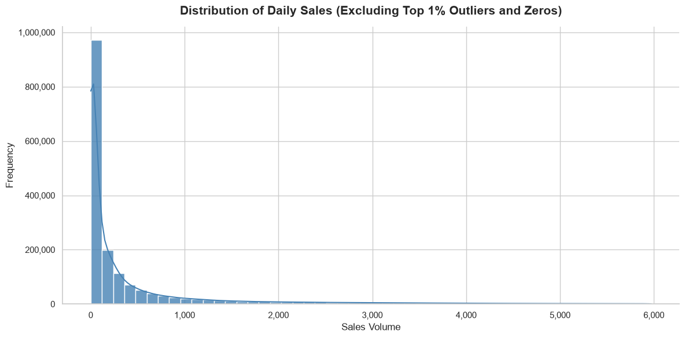
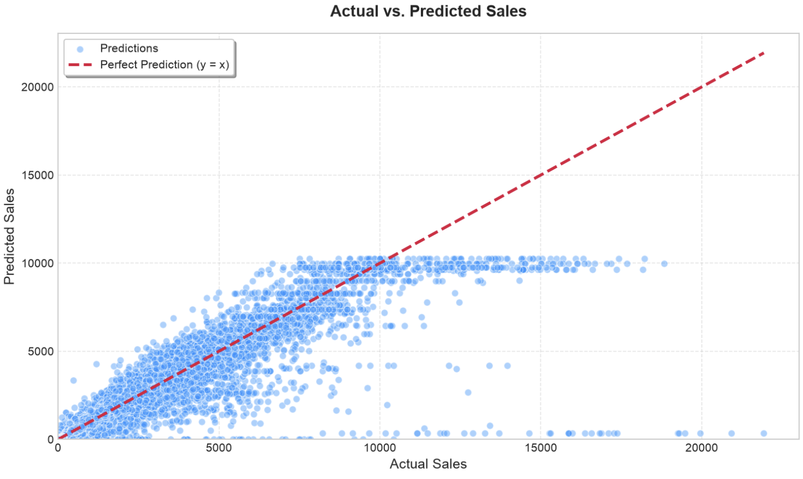
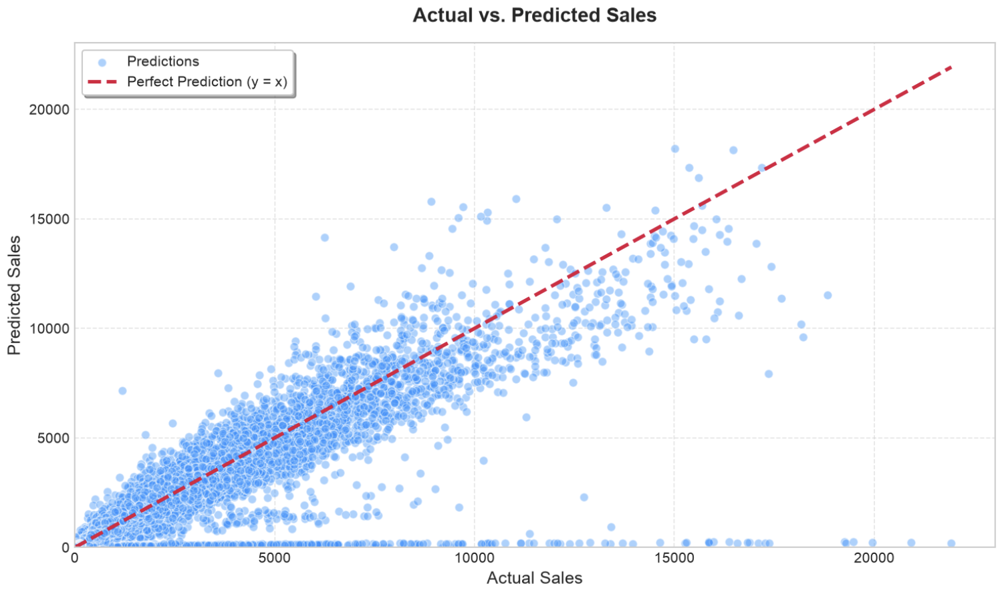
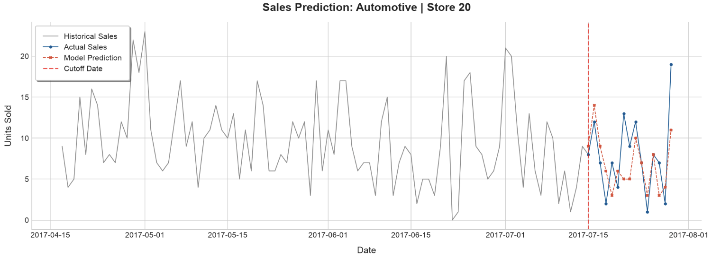

# 01. Modeling: Baseline & Diagnostics

> **WORK IN PROGRESS:** *This project is currently under active development.*

### Summary

Before engineering complex features, it is crucial to establish baseline models to understand the intrinsic mathematical behaviors and structural limitations of different algorithms when exposed to this specific dataset.

This phase of the project evaluates baseline forecasting models (Linear Regression and XGBoost) using exclusively autoregressive features (historical sales lags).

**Key Points:**
- **Unified forecasting approach:** A single model will be trained to forecast the entire 15-day horizon simultaneously.
- **Gradient Boosting as the primary engine:** The feature engineering phase will be optimized for gradient boosting architectures (specifically XGBoost). This algorithm was selected for its ability to model multiple time series and complex exogenous variables simultaneously, balancing high predictive accuracy with computational efficiency.
- **XGBoost hits a mathematical ceiling:** It handles low-sales variance well but is structurally incapable of extrapolating beyond historical maximums, creating a flat ceiling on extreme predictions.
- **Linear Regression is too rigid:** While it can extrapolate, its global linear nature imposes a high bias, systematically under-predicting peak sales events.

**Next Steps:**
The diagnostic proves that critical exogenous factors are missing. The next phase will focus heavily on **Feature Engineering** (incorporating holidays, promotions, and calendar events) to give the models the context needed to predict massive sales spikes.

---
### Method Selection

In time series forecasting, the objective is typically to predict multiple future time steps. Often, the most powerful predictors are lags (the historical values of the series). A lag X represents the value of the series exactly X periods in the past. However, as the forecast horizon extends further into the future, recent lags become unavailable, diminishing their predictive power. To address this, there are two primary approaches:
- **Direct forecasting:** Train a separate model for each forecast step, tailoring the lag selection for each horizon to strictly use available data and prevent data leakage.
- **Recursive forecasting:** Predict one step ahead, then feed that prediction back into the model as an input feature for the next time step.

To keep the baseline architecture simple, this analysis avoids separate direct models per step or recursive forecasting, opting instead for a single unified model restricted to horizon-safe lags (lag 15 and beyond). Dedicated multi-step forecasting architectures remain a strong avenue for future development in this project.

### Algorithm Selection & Trade-offs

While several algorithms are capable of modeling time-series data, no single model is perfect for every situation. The optimal choice depends entirely on the structural characteristics of the dataset, the computational budget, and the business constraints.

- **Parametric Statistical Models:** These algorithms provide solid predictions when their basic mathematical assumptions are met.
  - **Linear Regression:** Very fast and highly interpretable. It can naturally extrapolate to predict unprecedented high values. However, its rigid global approach means it has high bias, making it too simple to capture complex retail volatility.
  - **ARIMA / SARIMA:** Excellent at understanding a single time-series by finding internal trends and seasonality. While it can include external variables (ARIMAX), it operates on a single series at a time. Running it individually for thousands of store-item combinations is computationally prohibitive.
  - **Holt-Winters (Exponential Smoothing):** Efficiently models trends and seasonality by giving more weight to recent data. However, standard versions are blind to external events like promotions or holidays.
- **Prophet (by Meta):** Approaches forecasting by breaking down the time series into its main components: overall trend, seasonality, and holiday effects. It handles missing data very well. However, like ARIMA, it is fundamentally a univariate model (it must be trained series by series), making it computationally heavy to scale across thousands of store-item combinations. While it does accept exogenous variables, it models them additively and often struggles to capture the complex, non-linear feature interactions that tree-based models handle natively.
- **Gradient Boosting Algorithms (XGBoost, LightGBM):** The current standard for tabular data. They easily handle complex, non-linear relationships and categorical variables (like store types or cities). Their main drawbacks are a tendency to overfit and a mathematical inability to extrapolate beyond the historical data limits.
- **Deep Learning (TFT, LSTMs):** These are cutting-edge architectures that can learn incredibly complex patterns across many time-series at once. However, they require massive amounts of data, heavy GPU power, and long tuning times, making them unnecessarily complex for this baseline analysis.

Given that this project's dataset includes multiple time series and exogenous variables, gradient boosting models have been chosen to prioritize simplicity without sacrificing accuracy. However, a baseline linear regression model will also be implemented to illustrate specific structural limitations inherent to tree-based algorithms, such as their inability to extrapolate trends.

## Experiment Setup

To address the right-skewed distribution of the target variable, a logarithmic transformation was applied. Specifically, a `log1p` (`log(x + 1)`) transformation was utilized to safely handle zero-sales records, since `log(0)` is undefined. Consequently, training the model on this transformed space means the cost function implicitly minimizes the Root Mean Squared Logarithmic Error (RMSLE), thereby penalizing relative errors instead of absolute deviations. It should be noted that this transformation introduces a systematic forecasting bias, a mathematical phenomenon that will be analyzed in subsequent sections.

  
   
  <em>Figure 1: Distribution of daily sales.</em>

To rigorously test and evaluate the models, an expanding window time-series cross-validation approach was implemented. Four distinct cutoffs were selected, and all subsequent analysis is based on these validation splits.

*(Note: These cutoffs were strategically chosen to evaluate model performance across different seasonal periods of the year. The primary aim of this project is not merely to optimize for a Kaggle leaderboard score—which would dictate a different cutoff strategy tailored specifically to the competition's test set—but rather to build a robust, generalizable solution suitable for a production environment.)*

**Validation Strategy:** 4 distinct temporal cutoffs.
- *Cutoff 1:* 2016-09-15
- *Cutoff 2:* 2017-01-15
- *Cutoff 3:* 2017-04-15
- *Cutoff 4:* 2017-07-15

**Forecast Horizon:** 15 days.  
**Target Variable:** `sales` (transformed using `log1p` to stabilize variance and optimize for percentage errors).

**Feature Space (Baseline):**
- **Autoregressive Lags:** `sales_lag15`, `sales_lag21`, `sales_lag28`, `sales_lag364`.

## Linear Regression vs XGBoost

**Linear Regression** is a parametric statistical model that finds the optimal linear combination of independent variables to minimize the Mean Squared Error (MSE). Because it calculates continuous slope coefficients, it is inherently capable of unbounded extrapolation.

**XGBoost**, conversely, is a gradient boosting algorithm built on an ensemble of sequential decision trees. By design, tree-based models partition the feature space into orthogonal regions. Therefore, their predictions are mathematically bounded by the average of the target values present in their terminal leaf nodes during training.

Consequently, *XGBoost cannot extrapolate* beyond the historical maximums or minimums it has observed, whereas Linear Regression can naturally project trends into unseen numerical spaces. This inability to extrapolate trends is a well-known structural limitation of gradient boosting models when applied to time-series forecasting.

  
   
  <em>Figure 2: XGBoost Actual vs Predicted Sales.</em>

  
   
  <em>Figure 3: Linear Regression Actual vs Predicted Sales.</em>

This structural limitation is clearly visible in the scatter plots. Each point represents a single prediction for a specific store, family, and date. The red diagonal line represents perfect predictions ($y = \hat{y}$); ideally, all points should cluster tightly around it.

In the **XGBoost graph**, an invisible horizontal ceiling truncates the predictions. The model cannot predict values above approximately 11,000 units. In the **Linear Regression graph**, the model is able to predict beyond this limit, reaching values over 16,000. However, the Linear Regression shows high bias (it is too simple). We can see this bias visually because it systematically under-predicts high sales; the points for large values fall far below the red line.

For low sales (close to zero), XGBoost produces much smaller errors than Linear Regression, which is visible as a tighter group of points. Since both models use the same cost function (thanks to the log transformation, they minimize percentage errors, not absolute volumes), this difference is not about large numbers having bigger errors. Instead, it is about flexibility. Linear Regression has to draw one straight line for all the data, so it sacrifices accuracy on normal days to try to fit the extreme peaks. XGBoost solves this by dividing the data into different branches, allowing it to optimize low-selling days independently.

Even though they are very different algorithms, both models share a major problem: they fail to predict extreme sales peaks. The fact that both algorithms fail in the exact same way tells us that important information is missing. Because the models currently only use past sales (lags), they are blind to external events like holidays or special promotions.

To translate these global structural limitations into a practical business context, we can observe the temporal forecast for a specific slice of the data (e.g., Automotive in Store 20).

  
   
  <em>Figure 4: XGBoost Predictions for Automotive and Store 20.</em>

The model outputs a highly conservative, smoothed prediction line that oscillates safely around the historical mean. It completely fails to capture the true volatility of the sales, missing both the extreme peaks and the deep valleys. This visual confirmation reinforces the hypothesis that autoregressive lags alone are insufficient to anticipate sudden shifts in consumer behavior.

### Baseline Results & Conclusion

Averaging the performance across all four cross-validation cutoffs, the baseline models yielded the following Root Mean Squared Logarithmic Error (RMSLE):

- **Linear Regression Baseline:** 0.660
- **XGBoost Baseline:** 0.545

While XGBoost demonstrates a superior average performance—largely due to its ability to minimize residuals in the dense low-sales regime—both models share the critical inability to forecast demand spikes.

The mathematical diagnostics and the baseline scores confirm that tuning hyperparameters at this stage would be futile. The models do not need better math; they need better context.

> 👉 **[Read the full Feature Engineering report](02.%20Feature%20Engineering.md)** to explore the integration and analysis of exogenous variables (calendar holidays, time features, earthquake corrections, promotions...).

