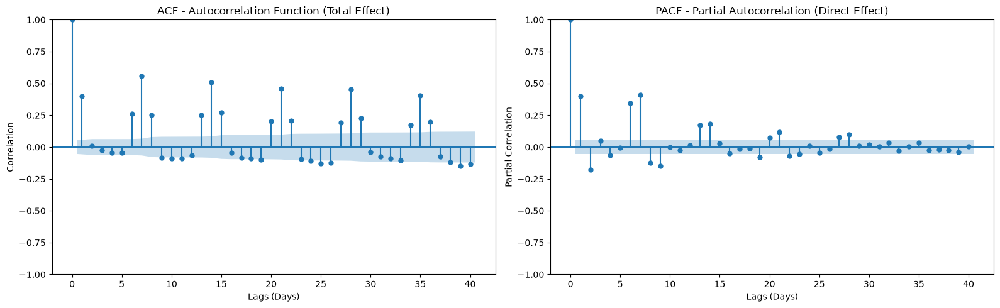
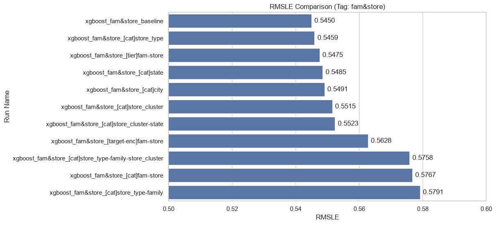
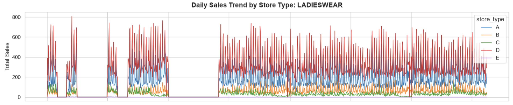
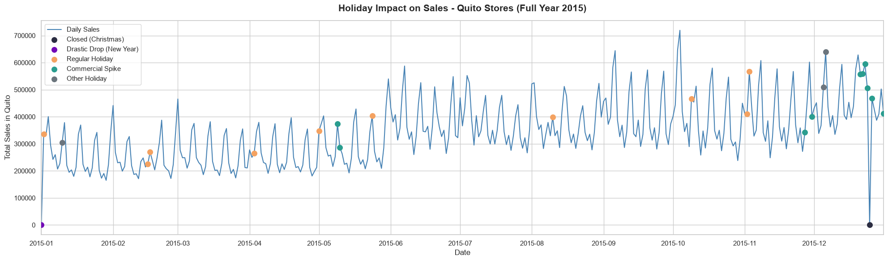
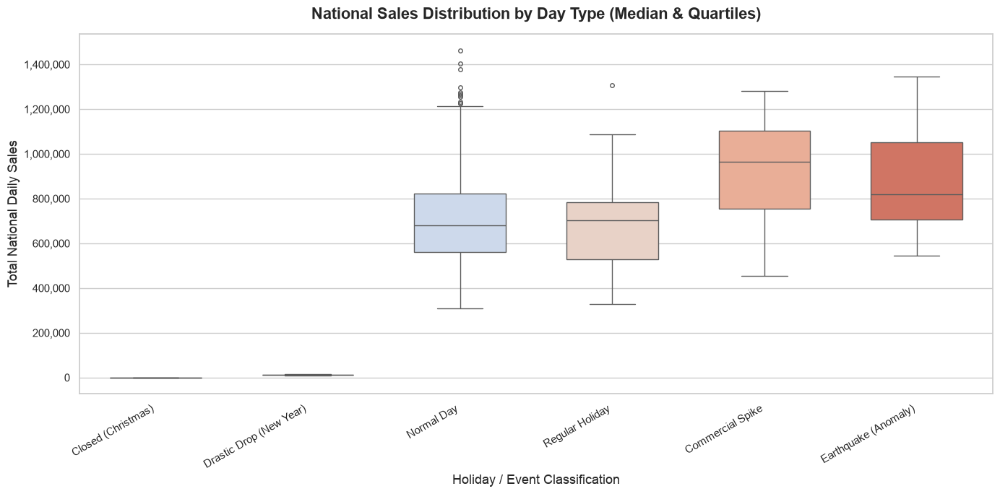
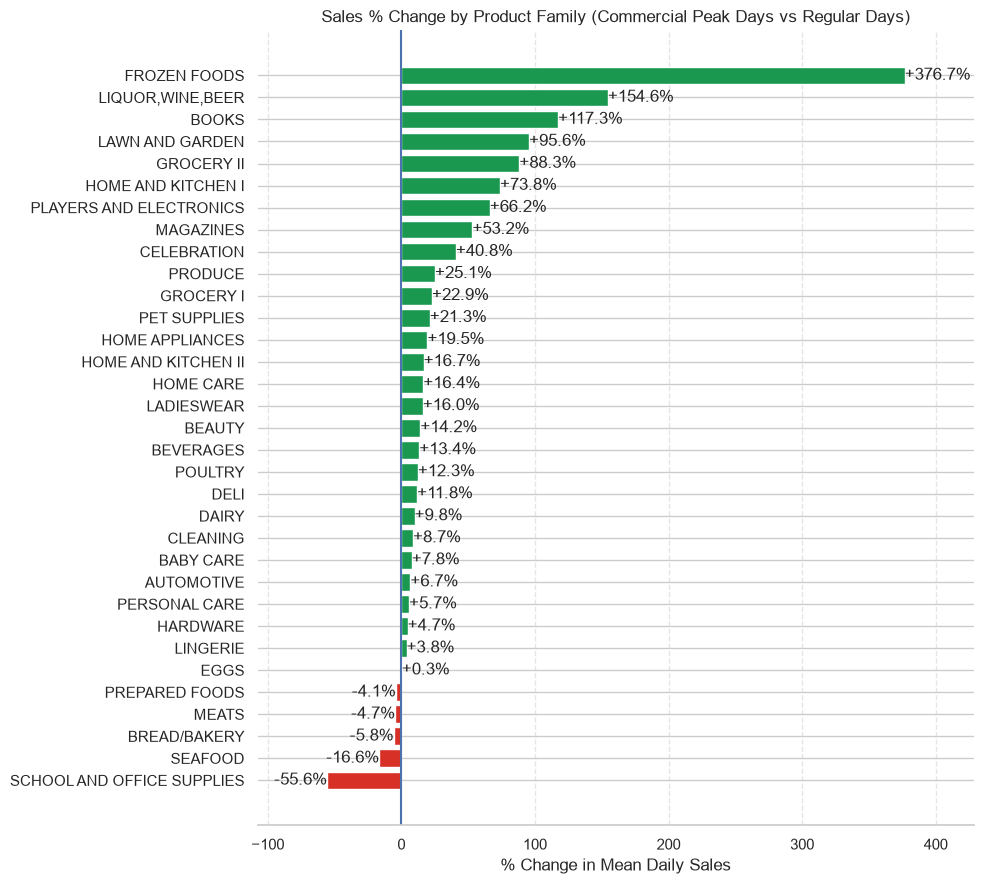
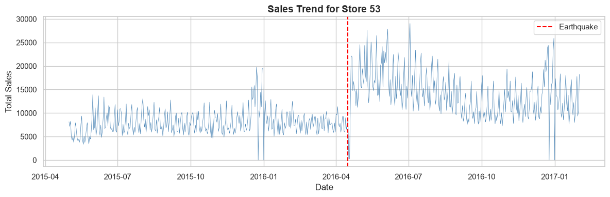
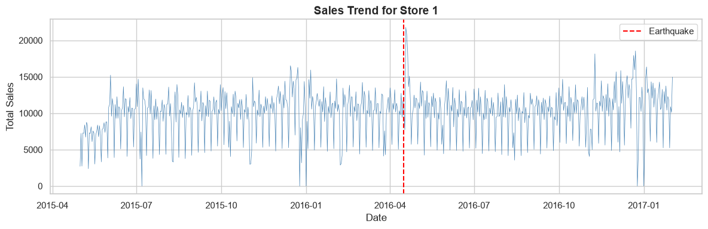
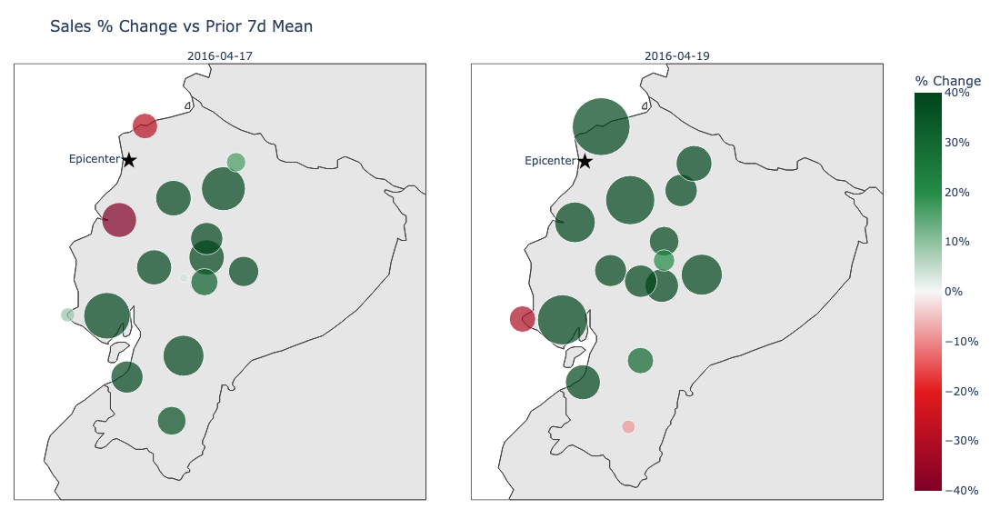
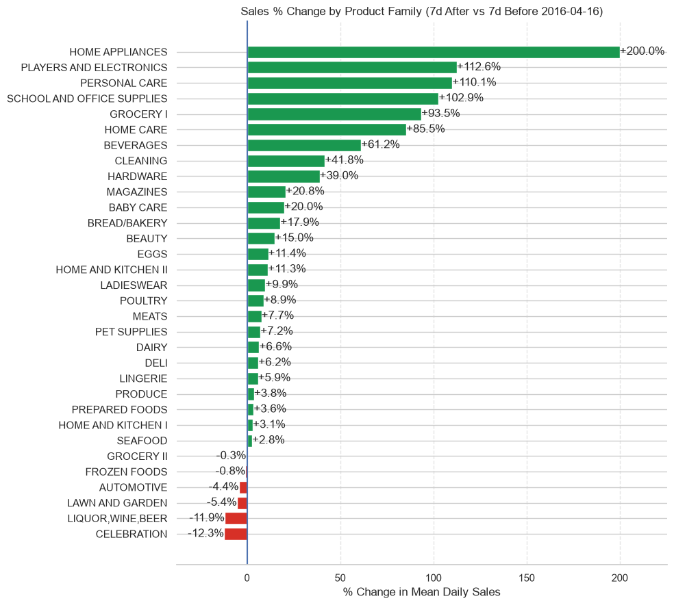

# 01. Modeling: Baseline & Diagnostics

> **WORK IN PROGRESS:** *This project is currently under active development.*

## Summary

Previous iterations have demonstrated that framing this project solely as an autoregressive problem is insufficient to achieve optimal predictive performance.
Therefore, this phase of the project evaluates the previous XGBoost baseline against more advanced models trained with an expanded feature space.

**Key Findings:**
- **Parsimonious Lag Baseline:** A 4-lag architecture (`[15, 21, 28, 364]`) achieves the best trade-off between accuracy (0.545 RMSLE) and simplicity, capturing weekly and yearly seasonality without overfitting to collinear noise.
- **Time, Store & Family Features:** Introducing explicit calendar variables or high-cardinality store/family attributes—across multiple encoding strategies—did not outperform the lag-only baseline, showing that historical lags already capture most baseline temporal and structural patterns.
- **Event Heterogeneity:** Holidays and external shocks (closures, commercial spikes, and the April 2016 earthquake) affect demand unevenly across geographies, post-event days, and product families, indicating that simple global flags are not enough.
- **Structural Bottlenecks:** Remaining error is driven less by missing features than by core model limitations: inability to extrapolate trends, zero-sales handling, and systematic negative bias from optimizing MSE in `log1p` space.

**Next Steps:**
- **Address Structural Model Limitations:** Test a hybrid linear + XGBoost model to enable extrapolation, evaluate Tweedie/Poisson objectives on raw sales to handle zero-inflated demand and reduce negative bias (monitoring the RMSLE trade-off), and explore a two-stage (hurdle) approach for zero sales.
- **Engineer Targeted Interactions:** Combine key events with top-affected product families and test explicit flags for zero-assortment store–family combinations.
- **Defer External Features:** Postpone `oil` prices and store `transactions` until the structural issues above are resolved.
---

## Feature engineering 

Feature engineering requires a solid understanding of how tree-based models split data, the business value of each variable and their interactions. To structure the experimentation phase systematically, the candidate features have been grouped into distinct categories:

### Algorithm Selection & Trade-offs

* **Lags:** Historical sales values at specific past intervals (e.g., 15 days, 364 days). These are crucial for capturing pure autoregressive patterns, recent demand trends, and yearly seasonality without the need for explicit date variables.
* **Time:** Temporal variables extracted from the raw date (day, weekday, week, month, year). These require careful encoding to avoid destroying the ordinal nature of time (via Categorical/One-Hot) or introducing data leakage (via Target Encoding).
* **Family and Stores:** High-cardinality categorical variables defining the product, store location and type.
* **Holidays and Other Events:** Regional and national holidays affecting store traffic.Earthquakes, public sector wage payment days, etc.
* **Oil:** Daily oil prices, which heavily impact Ecuador's economic landscape.
* **Transactions:** Store-level daily transaction volumes.

### Experiment Setup

The validation cutoffs remain consistent with previous iteration, while the forecast horizon is strictly defined by the problem statement.

As a reimainder: 
**Validation Strategy:** 4 distinct temporal cutoffs.
* *Cutoff 1:* 2016-09-15
* *Cutoff 2:* 2017-01-15
* *Cutoff 3:* 2017-04-15
* *Cutoff 4:* 2017-07-15

**Forecast Horizon:** 15 days.  
**Target Variable:** `sales` (transformed using `log1p`)

---

### Lags
The lags represent the autoregressive component of the model. These features are simply the sales of the corresponding store and product family shifted by X days into the past. Crucially, to strictly prevent data leakage across validation cutoffs, no lag shorter than the forecast horizon is permitted.

These lagged features are highly correlated, introducing severe multicollinearity when fitting a baseline linear regression. Consequently, the statistical traditional statistical inference becomes unreliable: the coefficients are artificially distorted. Furthermore, due to the massive dataset size, the standard errors are extremely small, causing almost all p-values to approach zero. This inflates statistical significance and makes p-values ineffective for feature selection.

To systematically address this and isolate the most predictive historical data, the Autocorrelation Function (ACF) and Partial Autocorrelation Function (PACF) were analyzed. These functions help determine precisely which lags should be retained while mapping the structural seasonality of the time series.

The ACF plot, which measures the total linear correlation, reveals a robust weekly seasonality through prominent and statistically significant spikes at exact weekly intervals. Meanwhile, the PACF plot isolates the direct, independent effect of each lag. It confirms that the most meaningful predictive signals occur at these exact weekly cycles.

  
   
  <em>Figure 1: ACF and PACF for product family GROCERY I in Store 44.</em>

Guided by these statistical insights, the feature set was optimized to retain only those capturing specific structural information without redundant noise: **lag 15** serves as the most recent available data point (baseline inertia); **lag 21** anchors the most recent identical weekday (weekly seasonality); **lag 28** captures the prior weekly cycle, enabling the tree-based model to calculate recent seasonal trend when evaluated against lag 21; and **lag 364** corresponds to the exact same day from the previous year (yearly seasonality).

Although expanding the XGBoost model to a dense set of 12 lag features yielded a marginal RMSLE improvement of just 0.008, this minimal gain is largely driven by overfitting to collinear noise rather than a true increase in predictive power. Applying the principle of parsimony, the highly robust 4-lag architecture ([15, 21, 28, 364]) was selected as the optimal balance between accuracy and model simplicity.

| Model | Feature Set | RMSLE | Bias |
| :--- | :--- | :--- | :--- |
| XGBoost (Dense) | 12 Lags (`[15-21], 28, 30, 60, 364, 365`) | 0.537 | -14.2 |
| XGBoost (Intermediate) | 8 Lags (`[15-19], 21, 28, 364`) | 0.542 | -29.1 |
| XGBoost (Minimal) | 3 Lags (`15, 21, 364`) | 0.559 | -21.1 |
| **XGBoost (Final Selected)** | **4 Lags (`15, 21, 28, 364`)** | **0.545** | **-22.4** |

### Time Features 

Categorial features can be introduced into the model through several encoding strategies. In this project, multiple approaches were evaluated to identify the configuration that minimizes the Global RMSLE:
- Native Categorical Encoding: Directly supported by modern gradient boosting frameworks (such as XGBoost). This approach is highly flexible, robust, and computationally efficient, carrying a lower risk of overfitting compared to target-based transformations.
- Target Encoding: While effective for strictly stable distributions, it tends to distort dynamic trends and structural seasonality by compressing time-dependent variance into static historical averages.
- Target-Guided Ordinal Encoding: Imposes a stricter monotonic relationship than native categorical handling. Although more restrictive, it acts as a regularization mechanism that helps constrain the model and reduce overfitting.
- Temporal Binning (Tiering / Grouping): Aggregates granular time units into broader, business-driven categories based on homogeneous behavior (e.g., early/mid/late month, peak/off-peak seasons, or weekday vs. weekend). By significantly reducing feature cardinality, this strategy helps the gradient boosting algorithm find cleaner, more robust splits, enhancing generalization and minimizing the risk of overfitting to specific micro-periods.
- One-Hot Encoding (OHE): Highly inefficient for tree-based algorithms when dealing with temporal data. Because gradient boosting models split on a single feature at a time, sparse binary matrices heavily dilute the information gain. This forces the model to require significantly deeper trees to capture the same interactions, exponentially increasing computational costs while risking underfitting.
  
Since modern XGBoost implementations offer native support for categorical variables, this was the initial approach explored due to its simplicity. However, the empirical results were not promising. Introducing temporal variables as pure categories forces the algorithm to fragment the data, destroying the sequential nature of time. Consequently, none of the categorical combinations outperformed the autoregressive baseline.

Other encoding techniques were also explored; however, they failed to provide any metric improvements for the temporal features.

Given the lack of significant RMSLE improvement and the additional complexity introduced to the pipeline, the baseline model was not be updated with explicit date variables. The pure autoregressive approach remains the most robust choice, proving that historical lags are already sufficient to capture the temporal variance.

### Stores and Family Features 

As seen with temporal variables, using XGBoost's native categorical handling on high-cardinality features (`family` and `store_nbr`) fragments the data and limits generalization. Consequently, adding them as native categories yielded no improvement in Global RMSLE over the pure autoregressive baseline.

Following the same experimental approach used for time features, alternative encoding techniques were tested across `family`, `store_nbr`, `store_cluster`, `store_type`, `city`, and `state`. None of the experiments outperformed the baseline, so the model remains unchanged.

  
   
  <em>Figure 2: Global RMSLE comparison across Store and Family feature experiments.</em>

Even though these features did not improve the baseline on their own, exploring them reveals clear structural patterns. In general, `store_type` acts as a proxy for store size, with types A and D driving the highest sales volumes. Beyond overall scale, it also reflects assortment differences: certain product families are simply not sold in specific store types.

  
   
  <em>Figure 3: Daily sales distribution by store type and product family.</em>

> **Next Steps:** A potential improvement would be to explicitly flag store–family combinations with zero assortment. However, the gain may be marginal, as the lag features already capture persistent zero-sales behavior.

### Holidays
The `holidays_events` dataset covers a wide range of events: national and regional holidays, the April 2016 earthquake, the FIFA World Cup, and commercial events like Black Friday. To extract clearer signals while keeping the feature space compact, the raw columns were engineered into more specific variables:

*   **`holiday_locale`, `holiday_description`, `holiday_type`:** Kept in their original categorical format to preserve the specific details of each event.
*   **`is_holiday`:** A binary column indicating the presence of any event from the dataset on a given day.
*   **`is_earthquake_manabi`:** A binary flag for the 30 days following the April 2016 earthquake, capturing the unusual and massive spike in sales during that period.
*   **`is_closed`:** A binary column strictly for Christmas Day, when stores are totally closed and sales drop to zero.
*   **`is_drastic_drop`:** A binary feature exclusively for January 1st, which shows a very particular behavior: extremely low sales, but still higher than zero.
*   **`is_commercial_spike`:** A binary indicator for promotional events that heavily boost sales, such as Black Friday or Mother's Day.
*   **`is_regular_holiday`:** A binary column grouping standard holidays (Carnival, Independence days, long weekends, and football matches) that share a similar sales pattern.
  

To see how these distinct calendar behaviors appear over a full year, the chart below plots total daily sales in Quito throughout 2015, clearly showing the year-start drop, commercial surges, and Christmas closure.

  
   
  <em>Figure 4: Total daily sales in Quito throughout 2015 by event type.</em>

Zooming out to the national level, the following boxplot compares daily sales distributions across event categories. As expected, sales drop to zero on Christmas Day and fall drastically on January 1st. Regular days show a wider upper range and more outliers than standard holidays (largely due to their much bigger sample size) though their medians remain similar. Finally, commercial spikes drive the largest jump in median sales (approaching 1M), while the earthquake period reaches the highest overall peaks, up to 1.35M.

  
   
  <em>Figure 5: National daily sales distribution by event type.</em>

The sales impact of each event varies substantially across product categories. The chart below compares mean daily sales by family on `is_commercial_spike` days versus regular days. Frozen Foods lead the ranking with more than three times their usual sales during these promotional events, whereas School and Office Supplies sit at the bottom, dropping to roughly half of their normal volume.

  
   
  <em>Figure 6: Sales percentage change by product family on commercial spike days vs. regular days.</em>

Focusing on the April 16, 2016 earthquake, the demand response depended heavily on proximity to the epicenter. In the affected coastal zone, sales initially dropped right after the disaster before surging strongly for an extended period. This pattern is evident at Store 53 in Manta—located over 100 km from the epicenter, where sales fell immediately before rebounding sharply.

  
   
  <em>Figure 7: Daily total sales for Store 53 (Manta) around the April 2016 earthquake.</em>

In contrast, at Store 1 in Quito, located far from the epicenter, sales began rising the very next day without an initial drop.

  
   
  <em>Figure 8: Daily total sales for Store 1 (Quito) around the April 2016 earthquake.</em>

These maps summarize the geographic shift by comparing each state's percentage change in daily sales on April 17 and April 19 against its prior 7-day average, alongside the earthquake epicenter. The day after the event (April 17), sales dropped sharply in the two coastal regions closest to the epicenter, while most of the country saw a strong increase. By April 19, those affected areas bounced back with a major spike in sales, likely driven by restocking and emergency aid.

  
   
  <em>Figure 9: Regional sales percentage change on April 17 and April 19 vs. the prior 7-day mean.</em>

Moreover, the post-earthquake surge was not distributed evenly across product categories. While overall sales spiked significantly in the week following the disaster, several non-essential categories actually experienced a drop in demand.

  
   
  <em>Figure 10: Sales percentage change by product family before vs. after the April 2016 earthquake.</em>

> **Next Steps:** Create interaction features combining specific product families with key events (such as flagging the top-affected categories for commercial spikes and the earthquake).

## Results & Conclusion

Remaining features, such as oil prices and store transactions, can be explored in the next phase of the project. Before adding them, however, several structural issues should be addressed—specifically the model's inability to extrapolate, handling zero-sales forecasts, and its negative bias.

These limitations could be tackled by:
- Combining a linear regression with XGBoost (a hybrid approach) to enable extrapolation.
- Switching to a Tweedie or Poisson objective on raw sales to better handle zero-inflated demand and reduce mean bias, while monitoring the potential trade-off against RMSLE.

