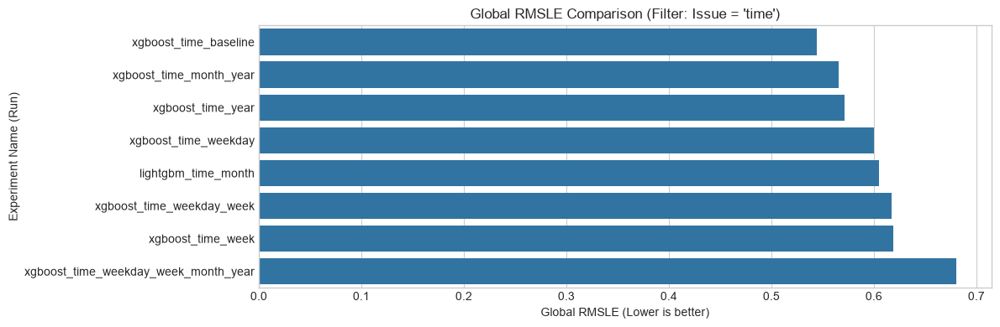
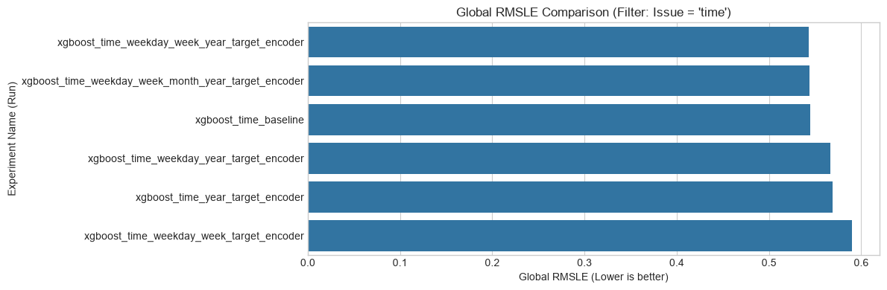
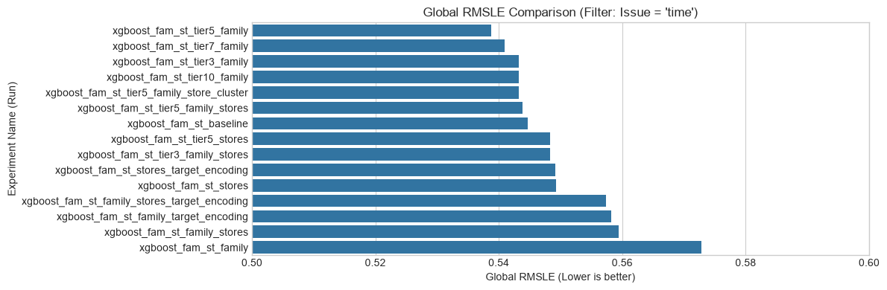

# 01. Modeling: Baseline & Diagnostics

> **WORK IN PROGRESS:** *This project is currently under active development.*

### 📌 Executive Summary

Previous iterations have demonstrated that framing this project solely as an autoregressive problem is insufficient to achieve optimal predictive performance.
Therefore, this phase of the project evaluates the previous XGBoost baseline against more advanced models trained with an expanded feature space.

**Key Findings:**

**Next Steps:** 

---

### 

Feature engineering requires a deep understanding of how tree-based models split on data, the intrinsic business value of each variable, and their interactions. To structure the experimentation phase systematically, the potential feature space has been grouped into distinct categories:

### Algorithm Selection & Trade-offs

* **Lags:** Historical sales values at specific past intervals (e.g., 15 days, 364 days). These are crucial for capturing pure autoregressive patterns, recent demand trends, and yearly seasonality without the need for explicit date variables.
* **Time:** Temporal variables extracted from the raw date (day, weekday, week, month, year). These require careful encoding to avoid destroying the ordinal nature of time (via Categorical/One-Hot) or introducing data leakage (via Target Encoding).
* **Family and Stores:** High-cardinality categorical variables defining the product and location.
* **Holidays:** Regional and national holidays affecting store traffic.
* **Other events:** Earthquakes, public sector wage payment days, etc.
* **Oil:** Daily oil prices, which heavily impact Ecuador's economic landscape.
* **Transactions:** Store-level daily transaction volumes.
* **Cleaning outliers:**

### Experiment Setup

The baseline is defined by the best-performing model utilizing exclusively autoregressive lags. The validation cutoffs remain consistent with previous iterations, while the forecast horizon is strictly defined by the problem statement.

As a reimainder: 
**Validation Strategy:** 4 distinct temporal cutoffs.
* *Cutoff 1:* 2016-09-15
* *Cutoff 2:* 2017-01-15
* *Cutoff 3:* 2017-04-15
* *Cutoff 4:* 2017-07-15

**Forecast Horizon:** 15 days.  
**Target Variable:** `sales` (transformed using `log1p` to stabilize variance and optimize for percentage errors).

**Feature Space (Baseline):**
* **Autoregressive Lags:** `sales_lag15`, `sales_lag16`, `sales_lag17`, `sales_lag18`, `sales_lag19`, `sales_lag20`, `sales_lag364`.

---

## Time Features

Time features can be introduced into the model through several encoding strategies. In this project, multiple approaches were evaluated to identify the configuration that minimizes the Global RMSLE.

Since modern XGBoost implementations offer native support for categorical variables, this was the initial approach explored due to its simplicity. However, the empirical results were not promising. Introducing temporal variables as pure categories forces the algorithm to fragment the data, destroying the sequential nature of time. Consequently, none of the categorical combinations outperformed the autoregressive baseline.

  
   
  <em>Figure 4: Global RMSLE - Time Feature Engineering - XGBoost with categorical features.</em>

When Target Encoding is applied to the time features, predictive performance marginally improves, yet the best iteration merely ties with the baseline. Furthermore, Target Encoding introduces two major mathematical risks for time series:
- Internal Temporal Leakage: Scikit-Learn's implementation relies on K-fold cross-validation during the fit phase, effectively using future sales to encode past dates within the training set.
- Trend Flattening: Applying it to sequential features like year is highly dangerous. If there is an underlying growth trend, predicting a completely new year during inference forces the Target Encoder to fall back to the global historical mean. This abruptly flattens the trend and degrades the forecast.

  
   
  <em>Figure 5: Global RMSLE - Time Feature Engineering - Target Encoding.</em>

Given the lack of significant RMSLE improvement and the mathematical risks added to the pipeline, the baseline model will not be updated with explicit date variables. The pure autoregressive approach remains the most robust choice, proving that historical lags are already sufficient to map the temporal variance.

## Stores and Family Features

As discussed previously, while modern XGBoost allows for native categorical feature handling, this approach forces the trees to fragment the data, limiting their capacity to generalize. Consequently, introducing high-cardinality categorical variables (such as family and store_nbr as native categories) yielded no improvement in the Global RMSLE compared to the pure autoregressive baseline.

Following the same procedure, Target Encoding was evaluated next. Consistent with the findings regarding temporal features, this approach failed to outperform the baseline, suffering from similar internal leakage and overfitting constraints.

However, a custom dynamic grouping approach successfully improved the predictive performance. This method discretizes categorical variables into ordinal "Volume Tiers". To achieve this without introducing temporal data leakage, the total historical sales for each category are summed using strictly the data available prior to the validation cutoff. A log1p transformation is then applied to compress the extreme magnitude differences between categories, allowing for the creation of balanced, mathematically proportional tiers.

This dynamic tiering strategy was tested on both family and store_nbr. Empirically, it only yielded a consistent RMSLE improvement (a 1% error reduction) when applied to product families, providing XGBoost with a clean, ordinal signal of baseline demand.
Finally, the static cluster variable (a predefined store grouping provided directly by the Kaggle dataset) was evaluated. While it managed to slightly outperform the baseline, its predictive gain was inferior to that of the dynamic family volume tiers.

  
   
  <em>Figure 7: RMSLE - Family and Store Features.</em>

## Holidays

### Baseline Results & Conclusion

